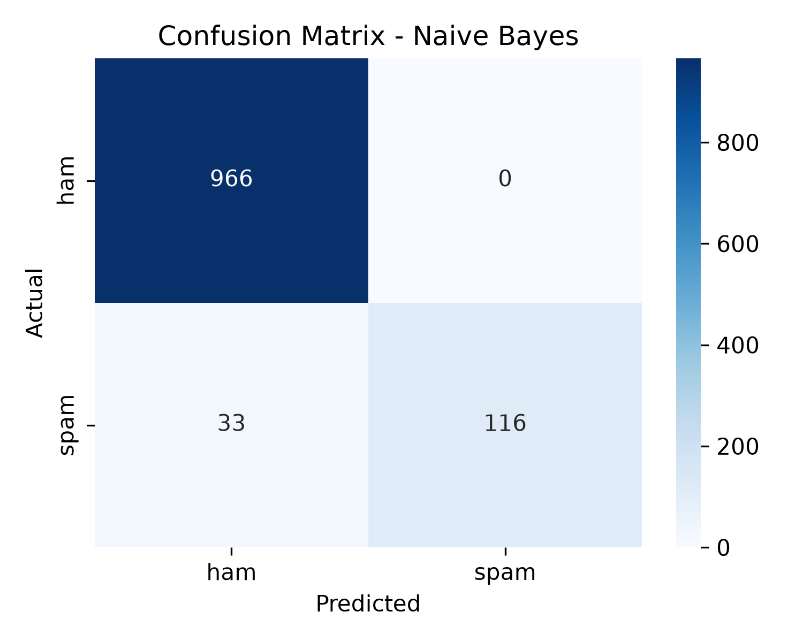
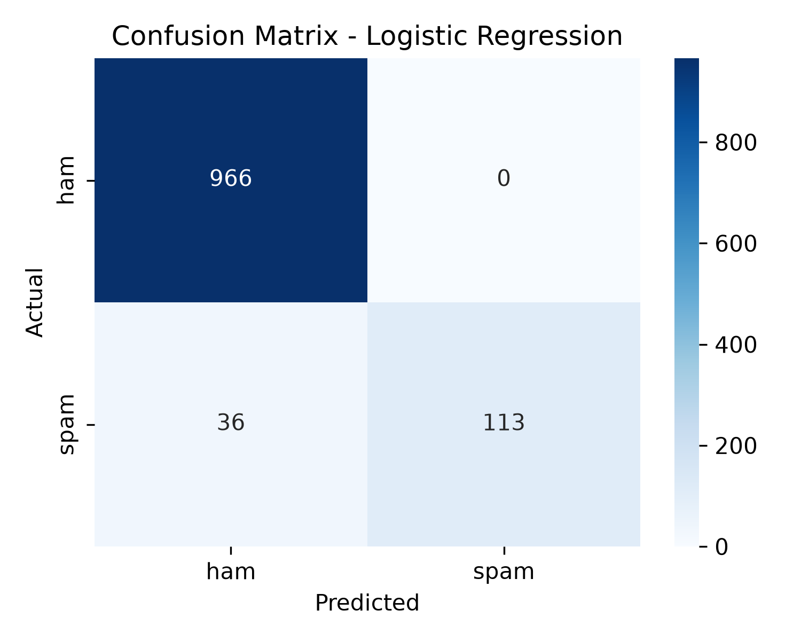

# Spam Message Classifier

An NLP project that classifies SMS messages as **spam** or **ham** (legitimate),
built for the CodeNova AI/ML Internship (Batch 01) - Task 2.

## Features
- Text preprocessing: lowercasing, stop-word removal, TF-IDF vectorization
- Compared two models: Multinomial Naive Bayes vs Logistic Regression
- Evaluation on a held-out test set (80/20 stratified split, no data leakage)
- Confusion matrix visualizations
- Saved model pipeline (`joblib`) and interactive prediction script

## Tech Stack
Python, Scikit-Learn, Pandas, Matplotlib, Seaborn, Joblib

## Dataset
[SMS Spam Collection (UCI)](https://archive.ics.uci.edu/dataset/228/sms+spam+collection)
- 5,572 messages (4,825 ham, 747 spam)
- Imbalanced data, so a stratified split was used.

## Setup
```bash
git clone <your-repo-link>
cd spam-classifier-codenova
python3 -m venv venv
source venv/bin/activate        # Windows: venv\Scripts\activate
pip install -r requirements.txt
```
Download the dataset from the link above and place `SMSSpamCollection` inside `data/`.

## Usage
```bash
python3 train.py      # trains models, saves metrics and confusion matrices
python3 predict.py    # interactive prediction (type 'quit' to exit)
```

## Results (held-out test set, 1,115 messages)

| Model | Accuracy | Precision | Recall | F1 |
|---|---|---|---|---|
| Naive Bayes | 0.9704 | 1.00 | 0.7785 | 0.8755 |
| Logistic Regression | 0.9677 | 1.00 | 0.7584 | 0.8626 |

Both models achieved perfect precision (no legitimate message was marked as spam).
Naive Bayes was selected for its higher recall and F1.

### Confusion Matrices



## Sample Prediction Logs

| Message | Prediction | Spam probability |
|---|---|---|
| Congratulations! You won a free iPhone. Click here to claim now | SPAM | 72.07% |
| URGENT! Your account is suspended. Call 09061234567 now | HAM (missed) | 46.43% |
| Hey, are we meeting for lunch tomorrow? | HAM | 0.21% |
| Can you send me the notes from today's class? | HAM | 2.82% |
| Free entry in a weekly competition, text WIN to 80085 | SPAM | 78.25% |

## Limitations
- Recall is ~0.78, so about 22% of spam messages are missed.
- The dataset is mostly older "prize/free entry" style spam, so modern phishing
  messages (e.g. "account suspended") can be missed.
- Training data is small and English-only.
- Possible improvements: threshold tuning, character n-grams, more recent data.